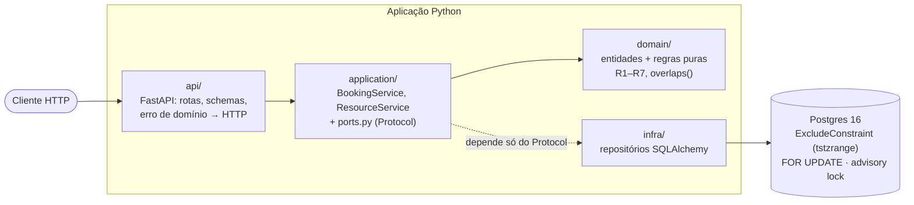
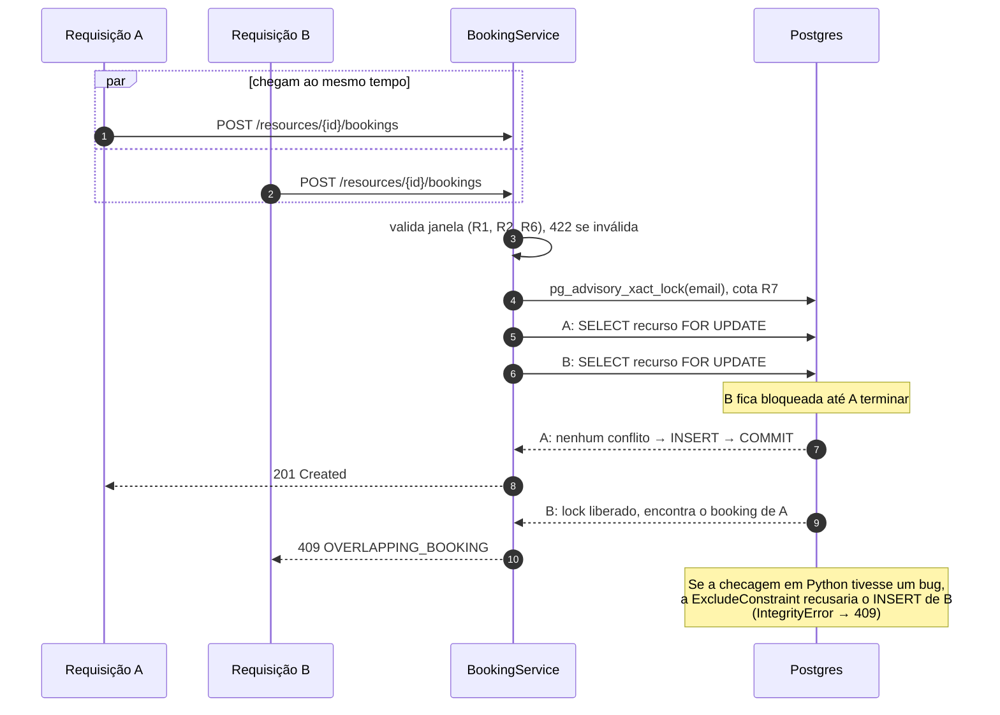

# Booking Concurrency API

Sistema de reservas de salas de reunião com garantia estrutural contra double-booking sob requisições concorrentes. A especificação completa (SDD) está em [`docs/spec.md`](docs/spec.md).

**Bootcamp III, Entrega 2** (publicação, refinamento por testes e análise crítica do uso de IA). Trabalho individual.

## O problema em uma frase

N requisições simultâneas para reservar o mesmo horário da mesma sala devem resultar em exatamente 1 sucesso, sempre, e isso precisa ser comprovado por teste automatizado, não por sorte de timing.

## Funcionalidades

| Método | Rota | O que faz |
|---|---|---|
| POST | `/resources` | Cadastra uma sala |
| GET | `/resources`, `/resources/{id}` | Lista salas e consulta uma sala |
| GET | `/resources/{id}/availability?start&end` | Diz se a sala está livre numa janela |
| POST | `/resources/{id}/bookings` | Reserva (409 se sobrepõe outra reserva ou se o solicitante já tem 3 ativas) |
| GET | `/resources/{id}/bookings`, `/bookings/{id}` | Lista e consulta reservas |
| PATCH | `/bookings/{id}` | Remarca uma reserva antes do início (RF8, Entrega 2) |
| DELETE | `/bookings/{id}` | Cancela uma reserva antes do início |

Contratos completos, regras de negócio (R1 a R7) e códigos de erro estão em [`docs/spec.md`](docs/spec.md#contratos-de-entradasaída). A documentação interativa (Swagger) fica em `http://localhost:8020/docs` com a API rodando.

## Arquitetura

Clean Architecture leve: as regras de negócio não sabem que existe banco nem HTTP, e só a camada `infra/` fala com o Postgres.



Cada camada tem a sua própria suíte de testes: `domain/` sem nenhuma infraestrutura, `application/` com um repositório fake em memória, e `infra/` + `api/` contra um Postgres real.

## Fluxo de uma reserva concorrente

O que acontece quando duas pessoas tentam reservar o mesmo horário no mesmo instante:



## Como rodar

Pré-requisito: Docker com Docker Compose. Python 3.12 só é necessário para rodar os testes fora de container.

```bash
git clone https://github.com/RCaslu/booking-concurrency-api.git
cd booking-concurrency-api
docker compose up -d db
docker compose up api
```

A API sobe em `http://localhost:8020`. A porta `8000` padrão do Uvicorn é mapeada para `8020` no host, para não conflitar com outros serviços (ver `docker-compose.yml`).

```bash
curl -X POST http://localhost:8020/resources \
  -H "Content-Type: application/json" \
  -d '{"name": "Sala A", "capacity": 8}'
```

## Como rodar os testes

Totalmente em container, sem instalar nada além do Docker:

```bash
docker compose up -d db-test
docker compose run --rm --build test
```

Ou localmente, com um virtualenv:

```bash
python3.12 -m venv .venv && source .venv/bin/activate
pip install -r requirements.txt
docker compose up -d db-test
PYTHONPATH=src pytest -v
```

Por categoria:

```bash
PYTHONPATH=src pytest -m unit           # regras de domínio, sem infra, milissegundos
PYTHONPATH=src pytest -m integration    # via API + Postgres real
PYTHONPATH=src pytest -m concurrency    # a prova de não-double-booking
```

O CI (GitHub Actions) roda a suíte completa contra Postgres em todo PR e todo push para `develop` e `main`. O log da última execução completa está em [`docs/test-evidence/`](docs/test-evidence/).

## Decisões de projeto (ADRs)

| ADR | Decisão | Por quê (e o que foi descartado) |
|---|---|---|
| [0001](docs/adr/0001-mecanismo-de-concorrencia.md) | `SELECT ... FOR UPDATE` no recurso + `ExcludeConstraint` | Um lock em memória não sobrevive a vários workers; o lock otimista exige retries não determinísticos. A constraint garante R3 mesmo com bug na aplicação |
| [0002](docs/adr/0002-postgres-desde-entrega-1.md) | Postgres desde a Entrega 1 | O SQLite não tem `ExcludeConstraint` e dá `database is locked` sob concorrência real |
| [0003](docs/adr/0003-sem-autenticacao-nesta-entrega.md) | Sem autenticação | Fora do foco (a garantia de concorrência). O schema já isola `requester_email` para adicionar autenticação depois |
| [0004](docs/adr/0004-fastapi-sincrono.md) | FastAPI e SQLAlchemy síncronos | O gargalo é o lock do Postgres, não I/O. O modo síncrono deixa o teste com threads direto e previsível |
| [0005](docs/adr/0005-invariantes-fora-de-r3.md) | Advisory lock para R7; pré-condição de R4 dentro do `UPDATE` | Nasceu de três bugs reais de checar e depois agir. Lock global e `SERIALIZABLE` foram descartados por serializar demais ou exigir retry |

## Governança e histórico

- **Branches:** `main` (protegida por conduta) ← `develop` ← `feature/*`. Nenhum commit direto em `main`.
- **Sprints:** Sprint 1 = PRs [#1](https://github.com/RCaslu/booking-concurrency-api/pull/1) a [#6](https://github.com/RCaslu/booking-concurrency-api/pull/6). Sprint 2 = milestone [Entrega 2](https://github.com/RCaslu/booking-concurrency-api/milestone/1), issues #8 a #13, cada uma fechada por um PR.
- **Revisão:** cada PR tem uma seção "AI Review" com os achados da skill `code-review` (corrigidos ou não, com justificativa) e passa pelo CI antes do merge. Como o trabalho é individual, a revisão por IA documentada faz o papel da revisão por par. As limitações disso estão discutidas em [`docs/ai-analise-critica.md`](docs/ai-analise-critica.md#4-a-centralidade-da-homologação-humana-no-fluxo-sdd).

## Documentação

| Documento | Conteúdo |
|---|---|
| [`docs/spec.md`](docs/spec.md) | Especificação SDD: requisitos, regras, contratos, decomposição e Refinamento |
| [`docs/erros-e-reespecificacao.md`](docs/erros-e-reespecificacao.md) | Todos os erros encontrados, como foram pegos, como foram corrigidos e o que mudou no spec |
| [`docs/ai-comparativo.md`](docs/ai-comparativo.md) | Experimento Claude Code × Cursor na mesma tarefa, com resultados medidos |
| [`docs/ai-analise-critica.md`](docs/ai-analise-critica.md) | Alucinação, vazamento de dados, propriedade intelectual e revisão humana |
| [`docs/ai-usage.md`](docs/ai-usage.md) | Como o Claude Code foi usado no fluxo SDD |
| [`CLAUDE.md`](CLAUDE.md) / [`AGENTS.md`](AGENTS.md) | Regras de contexto para os agentes de IA (o mesmo arquivo, lido por ferramentas diferentes) |

## Relato de experiência

**O que funcionou.** Escrever a especificação antes do código fez diferença concreta: quase todos os erros encontrados (ver o relatório de erros) foram pegos ao comparar o código com o spec, e não ao rodar a aplicação. O Postgres real desde o primeiro dia também se pagou: dois erros (o `tsrange` e um teste que provava a coisa errada) só existiam contra o banco de verdade.

**O que foi difícil.** Concorrência é a área em que os testes verdes mais enganam. O mesmo padrão de bug, checar um estado e agir sem atomicidade, apareceu três vezes (cota, cancelamento, remarcação). Na terceira, *duas* ferramentas de IA diferentes o reproduziram, mesmo com o requisito de concorrência escrito no prompt. Escrever o teste que realmente prova a race, e não só que o caminho feliz funciona, foi mais trabalhoso que escrever a correção.

**O que aprendi sobre trabalhar com IA.** O agente é rápido e bom na parte mecânica: camadas, testes, documentação. Mas ele erra de um jeito específico: produz código plausível, verde nos testes e sutilmente errado. O que mais melhorou a qualidade não foi trocar de modelo. Foi dar a ele um arquivo de regras do projeto (o `CLAUDE.md`), revisar todo PR contra a especificação e registrar cada erro para que a regra virasse critério de revisão.

**O que faria diferente.** Começaria com o critério "onde essa pré-condição é verificada, antes do lock ou dentro da escrita?" já na especificação (hoje registrado no ADR-0005), em vez de descobrir isso bug a bug. E, num projeto em equipe, colocaria um revisor humano em cada PR além da revisão de IA, porque as duas ferramentas testadas tiveram o mesmo ponto cego.
